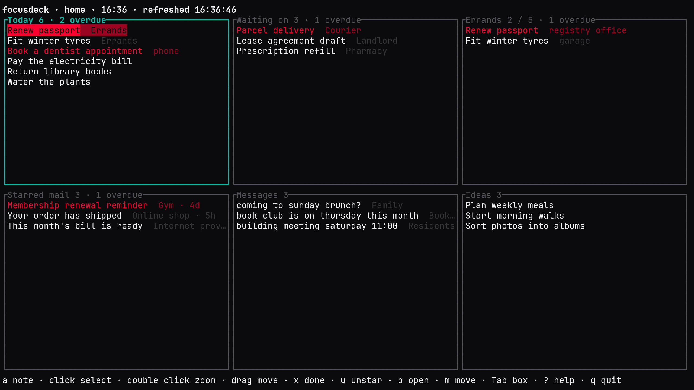
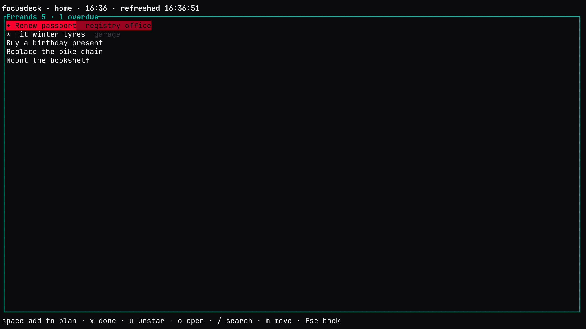
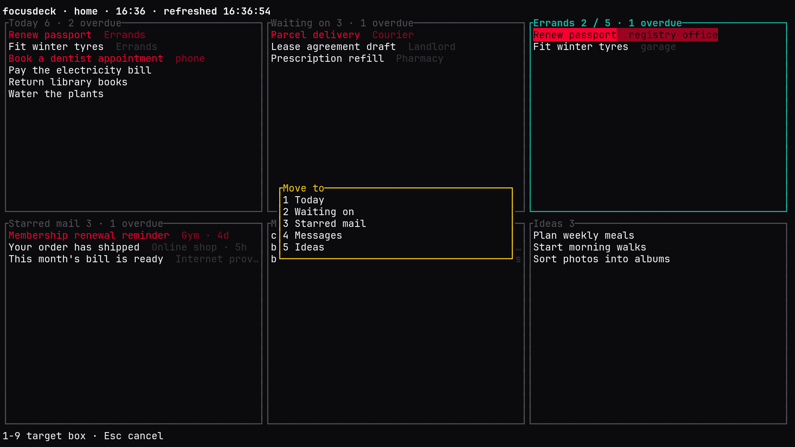
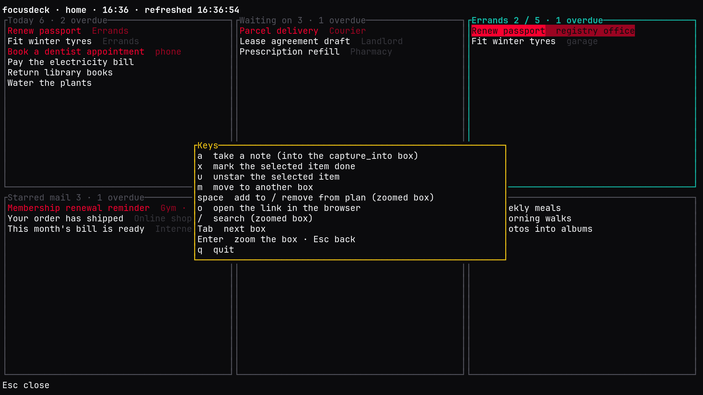

# focusdeck

**English** · [Türkçe](README.tr.md)

A terminal board for "everything that is waiting on me". Verbal promises, Redmine issues, starred mail and messages each sit in their own box on one screen. Boxes are filled by plugins, which are separate programs. You can drag items between boxes with the mouse, and the bottom line always tells you what each key does right now.

Targets Linux x86_64 and aarch64. The interface is available in English and Turkish, and a new language is one file (see [Translating](#translating)).



| Zoomed box | Move | Key list |
|---|---|---|
|  |  |  |

The data in the screenshots is made up.

## Install

```sh
cargo install --git https://github.com/omertahaoztop/focusdeck --tag v0.3.0 --locked focusdeck
```

Ready-made plugins live in the [focusdeck-plugins](https://github.com/omertahaoztop/focusdeck-plugins) repository and are installed from its index:

```sh
focusdeck plugin install vikunja
focusdeck plugin list
focusdeck plugin remove vikunja
```

Output of `focusdeck plugin list`:

```
vikunja  0.2.0  (in registry: 0.2.0)
local  (built-in)
```

`local` is built into focusdeck and always ends the list. `plugin install local` and `plugin remove local` are refused.

Plugins are written to `~/.local/share/focusdeck/plugins/<name>`. `install` checks the sha256 of the downloaded file against the index and deletes the file if it does not match. A reinstall that fails leaves the previous version in place. `remove` warns if a profile still uses the plugin.

> Plugins run with your user's permissions; there is no sandbox. Make sure you trust a plugin's source before installing it.

## Quick start

After `cargo install`, run `focusdeck`. With no profile chosen (`--profile`, `FOCUSDECK_PROFILE`, `default_profile`) and no file in `~/.config/focusdeck/profiles/`, it creates `profiles/notes.toml` with one box titled "Notes" (in the interface language) and opens it. Press `a`, type a line, and it is a note. `config.toml` is not written.

If `profiles/` holds exactly one profile, focusdeck opens it without being asked. With several profiles and no choice it exits with an error, so pick one as described in [Profile](#profile).

## Settings

`~/.config/focusdeck/config.toml`, every key optional:

```toml
language = "en"
default_profile = "home"
registries = ["https://raw.githubusercontent.com/omertahaoztop/focusdeck-plugins/main/index.toml"]
capture_command = ["rofi", "-dmenu", "-p", "Note"]

[capture_words]
tomorrow = ["tmrw"]
minute = ["mins"]
```

- `language`: the interface language, a code such as `en` or `tr` (see [Translating](#translating)). If it is missing, the core reads `LC_ALL`, `LC_MESSAGES` and `LANG`, in that order, and falls back to English. A cron job, systemd timer or window manager shortcut may not carry `LANG`, so set `language` if `capture` or `remind` run from one of them.
- `capture_words`: extra spellings for the words `capture` understands, added to the active language's own. Each key takes a list; the keys are `tomorrow`, `minute`, `hour`, `mon`, `tue`, `wed`, `thu`, `fri`, `sat`, `sun`, and an unknown key is an error.
- An unknown key anywhere in `config.toml` is an error, so a typo does not pass silently.
- `default_profile`: the profile used when neither `--profile` nor `FOCUSDECK_PROFILE` is given.
- `registries`: plugin index URLs, in order. If the same name appears in two indexes, the earlier one wins. Add your own index or a fork here.
- `capture_command`: the command run to ask for one line when `capture` is called without text.
- `[serve]`: `listen` and `token_file`, for `focusdeck server` (see [Server](#server)).
- `[server]`: `url` and `token_file`, to use a server instead of local profiles (see [Server](#server)).

## Profile

`~/.config/focusdeck/profiles/<name>.toml`. The profile is chosen from `--profile`, then `FOCUSDECK_PROFILE`, then `default_profile`.

```toml
name = "home"
capture_into = "verbal"
capture_refs = { R = "https://redmine.example.com/issues/{}" }
capture_label_aliases = { tel = "phone", f2f = "face-to-face" }

[[box]]
id = "verbal"
title = "Verbal promises"
plugin = "vikunja"
row = 0
col = 0
refresh = "1m"
config = { url = "https://vikunja.example.com", token_file = "~/.config/focusdeck/secrets/vikunja", project = "Home" }

[[box]]
id = "redmine"
title = "Redmine plan"
plugin = "redmine"
row = 0
col = 1
plan_into = "verbal"
config = { url = "https://redmine.example.com", key_file = "~/.config/focusdeck/secrets/redmine" }
```

- `row` and `col` are the grid position. Optional `width` and `height` stretch a box over several cells.
- The `config` table is passed to the plugin as is. Each plugin's keys are listed in its README.
- Secrets never go in the profile; only a file path (`token_file`, `key_file`) does. A leading `~` is expanded in every key ending in `_file`. If the file is readable by group or others, the box does not open (`chmod 600`).
- `plan_into`: in this box, the space key moves an item into the target box as "add to my plan". When the source plugin stops listing the item (the issue was closed), the linked target item counts as done too. No task is closed when the source `list` call fails.
- `capture_into`, `capture_refs` and `capture_label_aliases` configure the `capture` command below.

### Local box

A box with `plugin = "local"` is built in: nothing to install, and `config` can be left out.

```toml
[[box]]
id = "ideas"
title = "Ideas"
plugin = "local"
row = 1
col = 0
config = { list = "ideas" }
```

- `list` is the name of the note list and defaults to the box `id`. Boxes that use the same `list`, in any profile, show the same notes.
- `x` marks a note done. Notes can be moved (`m` or drag) and reordered, and the box accepts drops from other boxes: a Zulip message, a mail or a Redmine issue becomes a note.
- A note with a due date is shown as a reminder at that time by `focusdeck remind`.
- A local box can be the `plan_into` target of a Redmine box.

Notes are kept in `~/.local/share/focusdeck/local.json`, or in `$FOCUSDECK_DATA_DIR/local.json` if that variable is set. Copying this file is enough for a backup. Done notes stay in the file but are hidden from the box.

## Screen and keys

The main screen shows the profile's boxes in a grid. A box title shows its item count and how many are overdue; overdue items start with `!` and are red. The bottom line shows the keys for the current screen, and `?` opens the full list. Double click or `Enter` zooms a box, `Esc` goes back.

| Key | Main screen | Zoomed box |
|---|---|---|
| `a` | take a note (into the `capture_into` box) | same |
| `x` | mark the selected item done | same |
| `u` | unstar the selected item (Zulip) | same |
| `m` | move: opens the list of target boxes | same |
| `space` | none | in a box with `plan_into`: add to the plan; on an item already in the plan the first press asks, the second deletes it from the plan |
| `o` | open the link in the browser (`https`, `http` and `mailto` only) | same |
| `/` | none | search |
| `Tab`, `Shift+Tab` | next / previous box | none |
| `←` `→` | box to the left / right | none |
| `↑` `↓` | move in the list, at its top / bottom edge go to the box above / below | move in the list |
| `PageUp` `PageDown` `Home` `End` | none | move by a page, jump to the first / last item |
| `Shift+↑` `Shift+↓` | none | move the selected item up / down, where the plugin supports reordering |
| `?`, `q`, `Esc` | help, quit, back | help, quit, back |

Text pasted into the note or search field arrives as one line: line breaks become spaces. A paste on any other screen is ignored, so pasted text does not run as keys. This needs a terminal with bracketed paste, which current terminals have.

With `NO_COLOR` set to a non-empty value focusdeck uses no colours: the selection is shown in reverse video and overdue items keep their `!`.

Mouse:

- The wheel scrolls inside a box.
- A click selects an item, a double click zooms the box.
- Dragging an item onto another box sends `drop` to the target plugin. For example, dropping a Zulip or mail item onto a Vikunja box turns it into a task.
- Dragging within the same box reorders it. The top item has the highest priority.

## Capturing notes from outside

```sh
focusdeck capture "R12345 called #tel tomorrow 14:00 // details"
focusdeck capture
```

Without text, `capture_command` asks for one line. The note goes to the profile's `capture_into` box. The command exits with 1 if the title is empty or the plugin cannot be reached. A note that could not be delivered waits in `~/.local/state/focusdeck/capture-queue.jsonl` and is sent with the next successful capture. The note is written to that file before delivery starts, so a `capture` that is killed or interrupted loses nothing. Delivery is at least once: after a kill a note can reach the plugin twice. To bind it to a window manager shortcut (for example `F9` in Hyprland), `focusdeck capture` is enough.

Syntax:

- Everything after `//` is the description.
- If the last word of the title is a number with a unit, such as `30min` (minutes) or `2h` (hours), the due date and reminder are that long from now; if it is `HH:MM`, they are today at that time (tomorrow if already past). It can be preceded by the word for tomorrow or a weekday (see the words below).
- The first `@name` is who it is from. `#word` is a label, translated through `capture_label_aliases`. A digits-only `#123` stays plain text.
- A word that starts with a `capture_refs` prefix followed by at least two digits (`R12345`) becomes a link.
- The remaining words are the title.

The words depend on the interface language, are case-insensitive, and `capture_words` adds to them:

| Language | tomorrow | minute | hour | Monday to Sunday |
|---|---|---|---|---|
| `en` | `tomorrow` | `min`, `m` | `h` | `mon`/`monday`, `tue`/`tuesday`, `wed`/`wednesday`, `thu`/`thursday`, `fri`/`friday`, `sat`/`saturday`, `sun`/`sunday` |
| `tr` | `yarın`, `yarin` | `dk` | `s` | `pzt`/`pts`, `sal`, `çar`/`car`, `per`/`prş`/`prs`, `cum`, `cmt`, `paz` |

For example, in English `focusdeck capture "R12345 called #tel tomorrow 14:00"`; in Turkish `focusdeck capture "R12345 arandı #tel yarın 14:00"`.

## Reminders

```sh
focusdeck remind
focusdeck remind --send
```

Asks plugins that support reminders for the reminders of the last 12 hours. `remind` prints the ones that are due; `--send` shows them as notifications through `notify-send -u critical`. Shown reminders are recorded in `~/.local/state/focusdeck/reminded.json` and never shown again. A systemd timer or cron entry can run `focusdeck remind --send` every minute.

## Server

`focusdeck server` runs the boxes on one machine and lets other machines, or an app, use them over HTTPS. The server owns the profiles, the plugins, their secrets and `local.json`. A client shows the same boxes without any of those.

Server side, in `config.toml`:

```toml
[serve]
listen = "127.0.0.1:8740"
token_file = "~/.config/focusdeck/secrets/server-token"
```

- `listen`: the address to bind. It defaults to `127.0.0.1:8740`, so the server is not reachable from outside until you put a proxy in front of it or choose another address.
- `token_file`: the file that holds the bearer token. It must be at least 32 characters of visible ASCII (no spaces) and readable by its owner only (mode 0600), like the `*_file` keys of a profile.

Create the token once, and copy the same file to every client:

```sh
install -D -m 600 /dev/null ~/.config/focusdeck/secrets/server-token
openssl rand -hex 32 > ~/.config/focusdeck/secrets/server-token
```

Then run `focusdeck server`. The server does not speak TLS itself. A reverse proxy such as Caddy terminates it:

```
deck.example.com {
    reverse_proxy 127.0.0.1:8740
}
```

Client side, in `config.toml`:

```toml
[server]
url = "https://deck.example.com"
token_file = "~/.config/focusdeck/secrets/server-token"
```

- `url` must be `https://`. Plain `http://` is accepted only for `127.0.0.1`, `[::1]` and `localhost`, for testing.
- `token_file` follows the same rules as on the server.
- Each request times out after 20 seconds.

With a `[server]` section, the TUI, `capture` and `remind` talk to the server. The profile is chosen as usual (`--profile`, `FOCUSDECK_PROFILE`, `default_profile`), and when none is given the client takes the server's default profile or its only one. From the server come the profile (boxes, layout, `capture_into`, `capture_refs`, `capture_label_aliases`, `capture_words`), the items of every box and the result of every action, drop and capture. A local `[capture_words]` is ignored in client mode. The `plan_into` link runs only on the server and closes the linked tasks there, so two clients never finish the same task twice. Reminders are fetched from the server, but which ones were already shown is tracked per machine in its own `reminded.json`. Local `profiles/`, installed plugins and `local.json` are not used while `[server]` is set.

`capture` writes the note to its queue first. If the server is unreachable the note stays there and goes out with the next successful capture. A note leaves the queue for good only when the server answers `INVALID`. If the selected profile has no `capture_into`, the note stays queued and you are told why.

Without a `[server]` section focusdeck works locally exactly as before.

The API never returns the `config` table of a box or the paths of its secret files. Plugin error text is passed on unchanged, and the token is never written to the log or to an error message.

### API

Every request carries `Authorization: Bearer <token>`. Bodies and answers are JSON with snake_case fields, and a request body is limited to 1 MiB.

| Method | Path | Purpose |
|---|---|---|
| `GET` | `/api/v1/profiles` | profile names and the default one |
| `GET` | `/api/v1/profiles/{p}` | the profile view: capture settings and its boxes with their `describe` result |
| `GET` | `/api/v1/profiles/{p}/boxes/{b}/items` | the box's items and when they were listed |
| `POST` | `/api/v1/profiles/{p}/boxes/{b}/actions` | `item`, `action`, `args`: `done`, `delete`, `move`, `reorder`, `unstar` |
| `POST` | `/api/v1/profiles/{p}/boxes/{b}/drops` | `item`, `from`: drop an item from another box |
| `POST` | `/api/v1/profiles/{p}/captures` | `text`, `at`, `lang`: the server parses the note and files it into `capture_into` |
| `GET` | `/api/v1/profiles/{p}/reminders?since=<RFC 3339>` | reminders of all boxes since that time |

`drops` and `captures` take an `Idempotency-Key` header. A repeated key with the same body and target returns the first answer instead of doing the work twice; the same key sent to another box or profile gets `KEY_REUSED`. Once a request has its key, the work finishes even if the client hangs up, so a retry gets the stored answer. Keys older than 90 days are dropped when the server starts and whenever a new key is stored.

An error has the status below and the body `{"error": {"code": "...", "message": "..."}}`:

| Code | Status | Meaning |
|---|---|---|
| `UNAUTHORIZED` | 401 | missing or wrong token |
| `NOT_FOUND` | 404 | unknown profile or box; also a bad path or a wrong method |
| `INVALID` | 422 | the body, the query or the `Idempotency-Key` is malformed, or the note cannot be filed |
| `UNSUPPORTED` | 422 | the box's plugin does not support this action |
| `PLUGIN` | 502 | the plugin failed or did not answer |
| `IN_PROGRESS` | 409 | a request with the same `Idempotency-Key` is still running |
| `KEY_REUSED` | 422 | the `Idempotency-Key` was used with a different body or target |
| `INTERNAL` | 500 | the server could not save its own state |

## Plugin protocol

A plugin is a program the core starts once per box and keeps running. One JSON message per line: requests on stdin, responses on stdout. stderr goes to the core's log file. Protocol version 1.

```json
{"id": 7, "method": "list", "params": {"view": "full"}}
{"id": 7, "result": {"items": []}}
{"id": 8, "error": {"message": "401 Unauthorized"}}
```

| Method | Parameters | Response |
|---|---|---|
| `describe` | none | `name`, `version`, `protocol`, `actions`, `accepts_drop`, `reminders` |
| `configure` | the profile's `config` table | empty, `error` on bad settings |
| `list` | `view`: `summary` or `full` | `items` |
| `action` | `item`, `action` (`done`, `delete`, `move`, `reorder`, `unstar`), `args` | the updated item or empty |
| `drop` | `item`, `from` | the created or moved item |
| `reminders` | `since` (RFC 3339) | pairs of `at` and `item` |

- Each request times out after 15 seconds. A timeout, a non-JSON line, a line longer than 16 MiB or a crashed process shows up as a red line in the box; the core restarts the plugin on the next refresh, and other boxes are not affected.
- If `protocol` in the `describe` response differs from the version the core knows, the box does not open.
- The core only checks the `*_file` path and its permissions; the plugin reads the secret from the file itself, so the value never passes through the core.
- The core starts each plugin with the requested interface language in the `FOCUSDECK_LANG` environment variable (for example `tr`) and removes the variable when no language is set. A plugin that has no translation for it uses English.
- A plugin can be written in any language, as long as it speaks the protocol.

For plugins written in Rust, the `focusdeck-protocol` crate has the types, the `Plugin` trait and a `serve` helper that runs the line loop:

```toml
[dependencies]
focusdeck-protocol = { git = "https://github.com/omertahaoztop/focusdeck", tag = "v0.2.0" }
```

Implement the `Plugin` trait and call `focusdeck_protocol::serve(plugin, stdin.lock(), stdout)`.

## Security and privacy

- Plugin indexes and plugin files are fetched over HTTPS. Plain `http://` is refused, also as a redirect target; the exceptions are `127.0.0.1`, `[::1]` and `localhost`, for testing an index locally. An index fetched over the network cannot point a plugin at a local file or at these addresses.
- `plugin install` records the sha256 of the binary in a manifest next to it. Before a box starts that plugin, focusdeck compares the binary with the manifest and shows an error instead of starting a binary that changed. A plugin copied in by hand has no manifest and is not checked.
- The log, the capture queue, the reminder record and `local.json` are created readable and writable by the owner only (mode 0600).
- `~/.local/state/focusdeck/focusdeck.log` is moved to `focusdeck.log.1` once it passes 1 MiB, so it holds at most about 2 MiB.

## Translating

A language is one file: add `crates/focusdeck/locales/<code>.ftl` (for example `de.ftl`) in [Fluent](https://projectfluent.org/) syntax and rebuild; the file name is the code `language` and `LANG` match against.

- `en.ftl` is the base. Copy it and translate the values; message ids and `{ $variables }` stay as they are.
- `cargo test` fails with the missing or extra ids and the variables that differ from `en.ftl`, so an incomplete translation cannot slip through.
- The `capture-words-*` entries are space-separated lists of spellings, not sentences: `capture-words-tomorrow`, `capture-words-minute`, `capture-words-hour` and `capture-words-mon` to `capture-words-sun`. Write the spellings people actually type, lowercase or not, and include the unaccented variant if your keyboard layout makes it likely.
- Texts that a plugin prints are translated in the [focusdeck-plugins](https://github.com/omertahaoztop/focusdeck-plugins) repository, not here.

## Development

```sh
cargo test --workspace
cargo clippy --workspace --all-targets -- -D warnings
```

## License

MIT, see [LICENSE](LICENSE).
