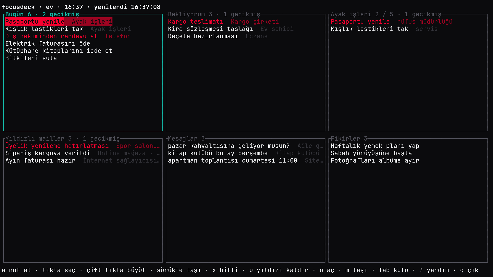
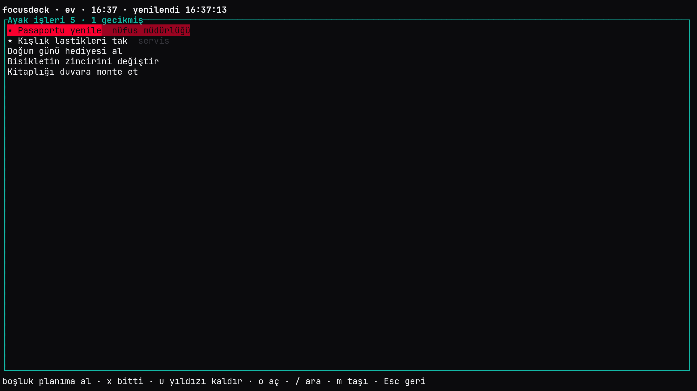
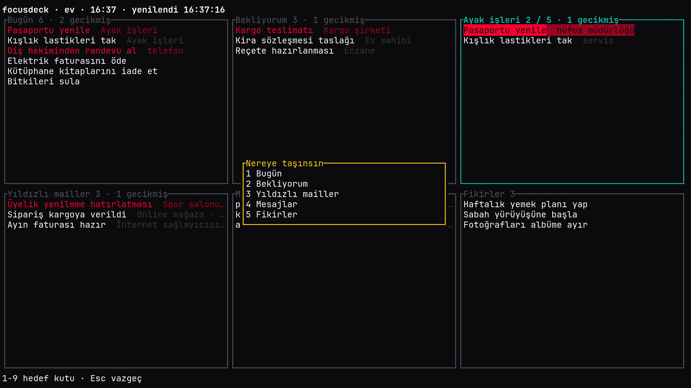
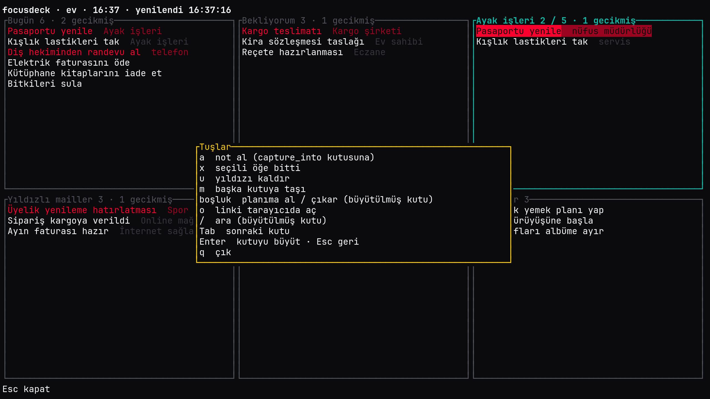

# focusdeck

[English](README.md) · **Türkçe**

Terminalde çalışan "bende bekleyen her şey" panosu. Sözlü verilen sözler, Redmine işleri, yıldızlı mailler ve mesajlar kaynak başına bir kutuda, tek ekranda durur. Kutuları ayrı programlar olan plugin'ler doldurur; fareyle taşınır, her an hangi tuşun ne yaptığı en alt satırda yazar.

Linux x86_64 ve aarch64 hedeflenir. Arayüz İngilizce ve Türkçe gelir, yeni bir dil tek dosyadır (bkz. [Çeviri](#çeviri)).



| Büyütülmüş kutu | Taşıma | Tuş listesi |
|---|---|---|
|  |  |  |

Görüntülerdeki veriler uydurmadır.

## Kurulum

```sh
cargo install --git https://github.com/omertahaoztop/focusdeck --tag v0.2.0 --locked focusdeck
```

Hazır plugin'ler [focusdeck-plugins](https://github.com/omertahaoztop/focusdeck-plugins) reposunda. Dizinden kurulur:

```sh
focusdeck plugin install vikunja
focusdeck plugin list
focusdeck plugin remove vikunja
```

Plugin'ler `~/.local/share/focusdeck/plugins/<ad>` altına yazılır. `install` dizinden indirdiği dosyanın sha256'sını doğrular, tutmazsa dosyayı siler. `remove` plugin'i hâlâ kullanan bir profil varsa uyarır.

> Plugin'ler kullanıcının yetkisiyle çalışır, kum havuzu yoktur. Bir plugin'i kurmadan önce kaynağına güvendiğinden emin ol.

## Ayarlar

`~/.config/focusdeck/config.toml`, hepsi isteğe bağlı:

```toml
language = "tr"
default_profile = "ev"
registries = ["https://raw.githubusercontent.com/omertahaoztop/focusdeck-plugins/main/index.toml"]
capture_command = ["rofi", "-dmenu", "-p", "Not"]

[capture_words]
tomorrow = ["yrn"]
minute = ["dak"]
```

- `language`: arayüz dili, `en` ya da `tr` gibi bir kod (bkz. [Çeviri](#çeviri)). Yoksa çekirdek sırayla `LC_ALL`, `LC_MESSAGES` ve `LANG` değişkenlerine bakar, hiçbiri yoksa İngilizceye düşer. Cron, systemd timer ya da pencere yöneticisi kısayolu `LANG` taşımayabilir; `capture` ya da `remind` bunlardan çalışıyorsa `language` yaz.
- `capture_words`: `capture` komutunun anladığı kelimelere ek yazımlar; etkin dilin kendi kelimelerine eklenir. Her anahtar bir liste alır; anahtarlar `tomorrow`, `minute`, `hour`, `mon`, `tue`, `wed`, `thu`, `fri`, `sat`, `sun`, bilinmeyen anahtar hatadır.
- `default_profile`: `--profile` ve `FOCUSDECK_PROFILE` verilmediğinde kullanılan profil.
- `registries`: plugin dizini adresleri, sırayla. Aynı ad iki dizinde varsa öndeki kazanır. Kendi dizinini ya da fork'unu buraya ekleyebilirsin.
- `capture_command`: `capture` metinsiz çağrılınca tek satır sormak için çalıştırılan komut.

## Profil

`~/.config/focusdeck/profiles/<ad>.toml`. Profil seçimi sırasıyla `--profile`, `FOCUSDECK_PROFILE`, `default_profile`.

```toml
name = "ev"
capture_into = "sozlu"
capture_refs = { R = "https://redmine.example.com/issues/{}" }
capture_label_aliases = { tel = "telefon", yuz = "yuz-yuze", "yüz" = "yuz-yuze" }

[[box]]
id = "sozlu"
title = "Sözlü işler"
plugin = "vikunja"
row = 0
col = 0
refresh = "1m"
config = { url = "https://vikunja.example.com", token_file = "~/.config/focusdeck/secrets/vikunja", project = "Ev" }

[[box]]
id = "redmine"
title = "Redmine planım"
plugin = "redmine"
row = 0
col = 1
plan_into = "sozlu"
config = { url = "https://redmine.example.com", key_file = "~/.config/focusdeck/secrets/redmine" }
```

- `row` ve `col` ızgara konumudur. İsteğe bağlı `width` ve `height` kutuyu birden çok hücreye yayar.
- `config` tablosu olduğu gibi plugin'e gider. Plugin'lerin ayar anahtarları kendi README'lerinde yazar.
- Şifreler profilde durmaz, yalnız dosya yolu (`token_file`, `key_file`) yazılır. Adı `_file` ile biten her ayarın başındaki `~` açılır. Dosya grup ya da başkaları tarafından okunabiliyorsa kutu açılmaz (`chmod 600`).
- `plan_into`: kutudaki öğeler boşluk tuşuyla hedef kutuya "planıma al" olarak taşınır. Kaynak plugin öğeyi artık listelemiyorsa (iş kapandı) bağlı hedef öğe de bitmiş sayılır. Kaynak `list` hata verdiğinde hiçbir görev kapanmaz.
- `capture_into`, `capture_refs` ve `capture_label_aliases` aşağıdaki `capture` komutunun ayarlarıdır.

## Ekran ve tuşlar

Ana ekranda profildeki kutular ızgarada durur. Kutu başlığı öğe sayısını ve gecikmiş sayısını yazar, gecikmiş öğe kırmızıdır. En alt satır o anki ekranın tuşlarını gösterir, `?` tam listeyi açar. Çift tık ya da `Enter` kutuyu büyütür, `Esc` geri döner.

| Tuş | Ana ekran | Büyütülmüş kutu |
|---|---|---|
| `a` | not al (`capture_into` kutusuna) | aynı |
| `x` | seçili öğe bitti | aynı |
| `u` | seçili öğenin yıldızını kaldır (Zulip) | aynı |
| `m` | taşı: hedef kutu listesi açılır | aynı |
| `boşluk` | yok | `plan_into` olan kutuda planıma al / çıkar |
| `o` | linki tarayıcıda aç | aynı |
| `/` | yok | ara |
| `Tab` | sonraki kutu | yok |
| `?`, `q`, `Esc` | yardım, çık, geri | yardım, çık, geri |

Fare:

- Tekerlek kutunun içinde kaydırır.
- Tıklama öğeyi seçer, çift tıklama kutuyu büyütür.
- Öğeyi başka kutuya sürükleyip bırakmak hedef plugin'e `drop` gönderir. Örneğin Zulip ya da mail öğesini Vikunja kutusuna bırakınca görev olur.
- Aynı kutu içinde sürüklemek sırayı değiştirir. En üstteki en önceliklidir.

## Dışarıdan not alma

```sh
focusdeck capture "R12345 arandı #tel yarın 14:00 // ayrıntı"
focusdeck capture
```

Metin verilmezse `capture_command` tek satır sorar. Not profildeki `capture_into` kutusuna gider; başlık boşsa ya da plugin'e ulaşılamıyorsa komut 1 ile çıkar. Ulaşılamayan not `~/.local/state/focusdeck/capture-queue.jsonl` dosyasında bekler ve sonraki başarılı yakalamada gönderilir. Bir pencere yöneticisi kısayoluna (örneğin Hyprland'de `F9`) bağlamak için `focusdeck capture` yeterlidir.

Yazım kuralları:

- `//` sonrası açıklamadır.
- Başlığın son kelimesi `30dk` (dakika) ya da `2s` (saat) gibi birimli bir sayıysa şimdiden o kadar sonra, `SS:DD` ise bugün o saat (geçmişse yarın) son tarih ve hatırlatma olur. Önüne "yarın" kelimesi ya da bir gün kısaltması konabilir (kelimeler aşağıda).
- İlk `@ad` kimden bilgisidir. `#kelime` etikettir ve `capture_label_aliases` ile çevrilir. Yalnız rakamdan oluşan `#123` düz metin kalır.
- `capture_refs` önekiyle başlayıp en az iki rakamla süren kelime (`R12345`) linke çevrilir.
- Geri kalan kelimeler başlıktır.

Kelimeler arayüz diline bağlıdır, büyük küçük harf ayırmaz ve `capture_words` üstüne ekler:

| Dil | yarın | dakika | saat | Pazartesi'den Pazar'a |
|---|---|---|---|---|
| `en` | `tomorrow` | `min`, `m` | `h` | `mon`/`monday`, `tue`/`tuesday`, `wed`/`wednesday`, `thu`/`thursday`, `fri`/`friday`, `sat`/`saturday`, `sun`/`sunday` |
| `tr` | `yarın`, `yarin` | `dk` | `s` | `pzt`/`pts`, `sal`, `çar`/`car`, `per`/`prş`/`prs`, `cum`, `cmt`, `paz` |

Örneğin Türkçe `focusdeck capture "R12345 arandı #tel yarın 14:00"`, İngilizce `focusdeck capture "R12345 called #tel tomorrow 14:00"`.

## Hatırlatma

```sh
focusdeck remind
focusdeck remind --send
```

Hatırlatma destekleyen plugin'lerden son 12 saatin hatırlatmalarını ister. `remind` saati gelenleri yazdırır; `--send` bunları `notify-send -u critical` ile bildirim olarak gösterir. Gösterilenler `~/.local/state/focusdeck/reminded.json` dosyasına yazılır, aynı hatırlatma bir daha gösterilmez. Dakikada bir çalışan bir systemd timer ya da cron girdisi `focusdeck remind --send` çalıştırabilir.

## Plugin protokolü

Plugin, çekirdeğin her kutu için bir kez başlatıp açık tuttuğu bir programdır. Satır başına bir JSON mesaj: stdin'den istek, stdout'tan cevap. stderr çekirdeğin log dosyasına yazılır. Protokol sürümü 1.

```json
{"id": 7, "method": "list", "params": {"view": "full"}}
{"id": 7, "result": {"items": []}}
{"id": 8, "error": {"message": "401 Unauthorized"}}
```

| Yöntem | Parametre | Cevap |
|---|---|---|
| `describe` | yok | `name`, `version`, `protocol`, `actions`, `accepts_drop`, `reminders` |
| `configure` | profildeki `config` tablosu | boş, hatalı ayarda `error` |
| `list` | `view`: `summary` ya da `full` | `items` |
| `action` | `item`, `action` (`done`, `delete`, `move`, `reorder`, `unstar`), `args` | güncellenmiş öğe ya da boş |
| `drop` | `item`, `from` | oluşturulan ya da taşınan öğe |
| `reminders` | `since` (RFC 3339) | `at` ve `item` çiftleri |

- İstek başına zaman aşımı 15 saniyedir. Zaman aşımı, JSON olmayan satır ya da süreç çökmesi kutuda kırmızı bir satır olarak görünür; çekirdek plugin'i bir sonraki yenilemede yeniden başlatır, öteki kutular etkilenmez.
- `describe` cevabındaki `protocol` çekirdeğin bildiği sürümden farklıysa kutu açılmaz.
- Çekirdek yalnız `*_file` yolunu ve izinlerini denetler; şifreyi plugin dosyadan kendisi okur, değer çekirdekten geçmez.
- Çekirdek her plugin'i istenen arayüz dilini `FOCUSDECK_LANG` ortam değişkeninde (örneğin `tr`) vererek başlatır, dil yoksa değişkeni kaldırır. Plugin'in o dilde çevirisi yoksa İngilizce kullanılır.
- Plugin herhangi bir dille yazılabilir, tek şart protokole uymak.

Rust ile plugin yazanlar için tipler ve `Plugin` trait'iyle satır döngüsünü yürüten `serve` yardımcısı `focusdeck-protocol` crate'inde durur:

```toml
[dependencies]
focusdeck-protocol = { git = "https://github.com/omertahaoztop/focusdeck", tag = "v0.2.0" }
```

`Plugin` trait'ini uygulayıp `focusdeck_protocol::serve(plugin, stdin.lock(), stdout)` çağırmak yeter.

## Çeviri

Bir dil tek dosyadır: [Fluent](https://projectfluent.org/) söz diziminde `crates/focusdeck/locales/<kod>.ftl` ekle (örneğin `de.ftl`) ve yeniden derle; dosya adı, `language` ve `LANG` değerinin eşleştiği koddur.

- Temel `en.ftl` dosyasıdır. Kopyala, değerleri çevir; mesaj kimlikleri ve `{ $değişken }` adları olduğu gibi kalır.
- `cargo test`, eksik ya da fazla kimlikleri ve `en.ftl`'den farklı değişkenleri söyleyerek düşer; yarım bir çeviri içeri giremez.
- `capture-words-*` girdileri cümle değil, boşlukla ayrılmış yazım listesidir: `capture-words-tomorrow`, `capture-words-minute`, `capture-words-hour` ve `capture-words-mon` ile `capture-words-sun` arası. İnsanların gerçekten yazdığı biçimleri koy; klavye düzeni yüzünden aksansız yazım olası ise onu da ekle.
- Bir plugin'in yazdığı metinler burada değil, [focusdeck-plugins](https://github.com/omertahaoztop/focusdeck-plugins) reposunda çevrilir.

## Geliştirme

```sh
cargo test --workspace
cargo clippy --workspace --all-targets -- -D warnings
```

## Lisans

MIT, bkz. [LICENSE](LICENSE).
